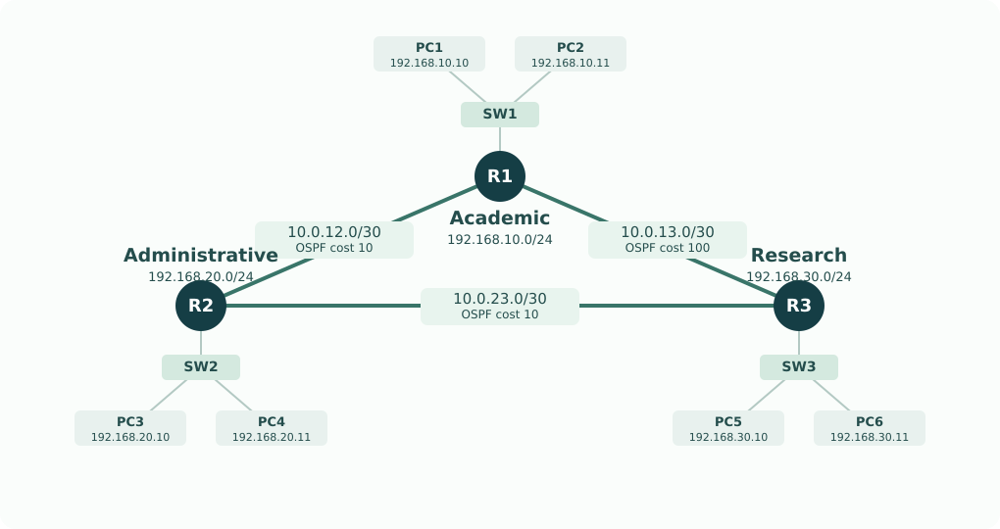

# Multi-department university network using RIP v2 and OSPF

**Group 11** · Banibrata Jana, Sudip Das, Mintu Jana and Subhankar Maity

A three-router campus connects the Academic, Administrative and Research buildings. The same links carry traffic differently depending on the routing protocol. RIP takes the direct link from Academic to Research. With the report’s configured costs, OSPF takes the two-link path through Administration.



## Run the project

Download and extract the project. Open **index.html** in Edge, Chrome or Firefox. All code runs locally. Select a protocol and two PCs, inspect any router's table, then disable or restore a link. The interactive model supports disconnected networks and same-LAN traffic.

For the Cisco Packet Tracer experiment, use the [port map and configuration guide](docs/packet-tracer.md) and the router commands in [configs/rip](configs/rip) and [configs/ospf](configs/ospf). Native Packet Tracer files and Cisco convergence timings are pending. The new screenshots below come from the included model's desktop results viewer.

## Results from this run

PC1 (192.168.10.10) sent traffic to PC5 (192.168.30.10). Each row is the stable state after the specified change. The single-link failures are separate experiments starting from the intact triangle.

| Link state | RIP forwarding path | RIP hops | OSPF forwarding path | OSPF cost | Reachable PC pairs under each protocol |
| --- | --- | ---: | --- | ---: | ---: |
| All links up | R1 → R3 | 1 | R1 → R2 → R3 | 21 | 30/30 |
| R1–R2 down | R1 → R3 | 1 | R1 → R3 | 101 | 30/30 |
| R1–R3 down | R1 → R2 → R3 | 2 | R1 → R2 → R3 | 21 | 30/30 |
| Failed link restored | R1 → R3 | 1 | R1 → R2 → R3 | 21 | 30/30 |

The OSPF metric includes the cost of R3’s outgoing interface to the Research LAN. With all links up it is 10 + 10 + 1 = 21. The direct path costs 100 + 1 = 101. RIP counts each inter-router hop once. The redundant triangle keeps all six PCs reachable after any one inter-router link fails.

The model exchanges RIP distance vectors and floods operational link information before running Dijkstra for OSPF. Its tables show departmental LAN routes. The connectivity probe follows each router’s selected next hop and checks the return path. Link changes trigger a new steady-state calculation. Protocol timers, transient packet loss, ICMP packets on a wire and elapsed convergence time are outside the model.

## Screenshots and evidence

| Experiment | Capture |
| --- | --- |
| Campus topology and IPv4 setup | [Topology](screenshots/00-campus-topology.png) · [Interface and PC addresses](screenshots/01-topology-and-addresses.png) |
| RIP routing and connectivity | [R1 routes](screenshots/02-rip-routes-and-interfaces.png) · [PC1 to PC5](screenshots/03-rip-reachability-and-trace.png) |
| OSPF routing and connectivity | [R1 table and neighbors](screenshots/04-ospf-routes-and-neighbors.png) · [PC1 to PC5](screenshots/05-ospf-reachability-and-trace.png) |
| OSPF reroutes when R1–R2 fails | [Failure](screenshots/06-ospf-link-failure.png) · [Recovery](screenshots/07-ospf-link-restored.png) |
| RIP reroutes when R1–R3 fails | [Failure](screenshots/08-rip-link-failure.png) · [Recovery](screenshots/09-rip-link-restored.png) |

The [original PDF](docs/Group_11.pdf) specifies the addressing and experiments. Its [four original screenshots](docs/report-figures) use example configurations, including serial interfaces and different addresses. They are retained for reference. The [recorded observations](results/observations.json) contain the model’s output for both protocols.

## Reproduce the results

With Node.js installed, run these commands from the project folder:

```sh
node lab/run.js rip routes
node lab/run.js ospf probe
node lab/run.js ospf recovery
node tests/verify.js
```

The tests compare calculated metrics and reachability against independently enumerated paths for all eight combinations of link states, both protocols and all 36 source/destination choices (including each PC to itself). They also check the six Cisco configurations against the model. Run `node tests/verify.js --export` to regenerate the JSON results.

The optional desktop viewer uses Node.js, Python 3 and PyQt5. Run `python lab/results_viewer.py` to inspect the command output, or `python lab/results_viewer.py --capture` to regenerate the screenshots. The browser lab only needs the extracted files.
