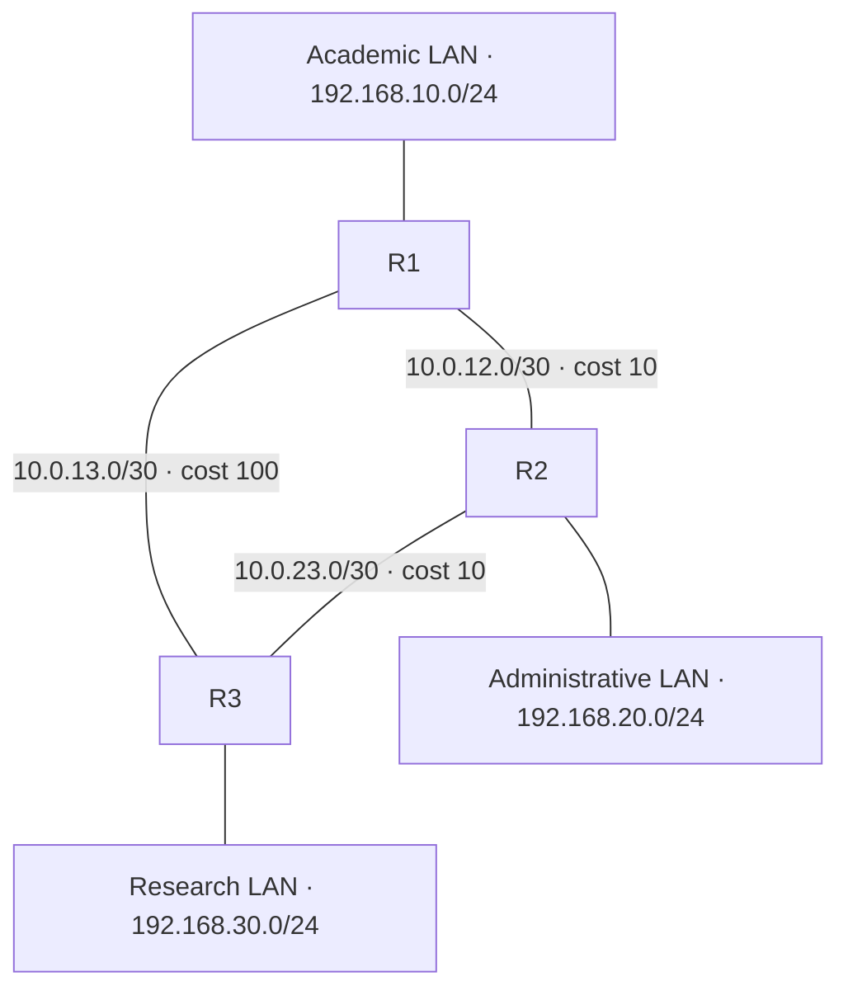

# University Network Design Using RIP and OSPF

Group 11 · Computer Networks · Cisco Packet Tracer

Three buildings share a campus network. From the Academic building, a packet can reach Research directly or pass through Administration. This lab uses the same cabling and addresses in two simulations to show how hop count and configured OSPF cost affect that choice.

## Topology



Each LAN contains one Cisco 2960 switch and two PCs. The costs shown are for the OSPF experiment.

## Build the lab

1. Add three Cisco 2911 routers, three 2960 switches and six PCs. Use the automatic cable selection tool. Connect each router's G0/0 to its building switch and connect two PCs to that switch.
2. Connect the routers using the exact ports below. The configuration files assign these addresses automatically.

| First router port | IPv4 | Second router port | IPv4 | Mask |
| --- | --- | --- | --- | --- |
| R1 G0/1 | 10.0.12.1 | R2 G0/1 | 10.0.12.2 | 255.255.255.252 |
| R1 G0/2 | 10.0.13.1 | R3 G0/2 | 10.0.13.2 | 255.255.255.252 |
| R2 G0/2 | 10.0.23.1 | R3 G0/1 | 10.0.23.2 | 255.255.255.252 |

3. On each PC, open **Desktop → IP Configuration → Static**. Use the mask **255.255.255.0** for every PC.

| Department | PC addresses | Default gateway |
| --- | --- | --- |
| Academic | PC1 192.168.10.10, PC2 192.168.10.11 | 192.168.10.1 |
| Administrative | PC3 192.168.20.10, PC4 192.168.20.11 | 192.168.20.1 |
| Research | PC5 192.168.30.10, PC6 192.168.30.11 | 192.168.30.1 |

4. Save this cabled topology as a base file. Use **File → Save As** to make a RIP copy. Open each router's **CLI**, answer `no` if the setup dialog appears, and press Enter until the `Router>` prompt appears. Paste the contents of the matching file from [configs/rip](../configs/rip) into each router (R1.txt on R1, and so on). Save the simulation.
5. Reopen the base file, save a separate OSPF copy and repeat with [configs/ospf](../configs/ospf). Each experiment starts from the same base with a single routing protocol.

## Verify the two paths

On R1 in each simulation, run:

```text
show ip interface brief
show ip protocols
show ip route 192.168.30.0
```

On R1 in the OSPF simulation, also run `show ip ospf neighbor`. With all three links up, R1 should form two full neighbor relationships.

On PC1, open **Desktop → Command Prompt** and run:

```text
ping 192.168.30.10
tracert 192.168.30.10
```

| Simulation | Expected next hop on R1 for the Research LAN | Reason |
| --- | --- | --- |
| RIP v2 | 10.0.13.2 (R3) | R3 advertises its LAN directly to R1, one RIP hop away. |
| OSPF Area 0 | 10.0.12.2 (R2) | The two links via R2 cost 20 in total. The direct link costs 100. Both paths add the same final cost for R3's LAN. |

## Observe a link failure

In each simulation, disable R1's **G0/1** link to R2. Record the route to the Research LAN before and after the change. RIP should keep forwarding directly to R3. OSPF should move from the path via R2 to the direct R3 link once routing settles.

```text
enable
configure terminal
interface GigabitEthernet0/1
 shutdown
end
show ip route 192.168.30.0
```

Repeat the PC1 ping and traceroute. Restore the link on R1:

```text
configure terminal
interface GigabitEthernet0/1
 no shutdown
end
```

Repeat the checks once the routes settle.


## Capture the Cisco evidence

Save the two experiments as separate files, such as `campus-rip.pkt` and `campus-ospf.pkt`. For each experiment, capture the labeled topology and the following live output:

| Device | Evidence to capture |
| --- | --- |
| Each router | `show ip interface brief` and `show ip protocols` |
| R1 | `show ip route` before failure, after failure, and after restoration |
| R1 in OSPF mode | `show ip ospf neighbor` and `show ip ospf database` |
| PC1 | `ping 192.168.30.10` and `tracert 192.168.30.10` |

To reproduce the RIP-specific failure capture, disable R1 G0/2 (toward R3), then restore it. For a like-for-like comparison, run each link failure separately under both protocols. Restore one link before testing the other. In Simulation mode, record the link-change timestamp, the time when the forwarding route stabilizes, and the first successful end-to-end probe after the change. Note whether the selected path changed. Keep the same probe interval and event settings across runs.
